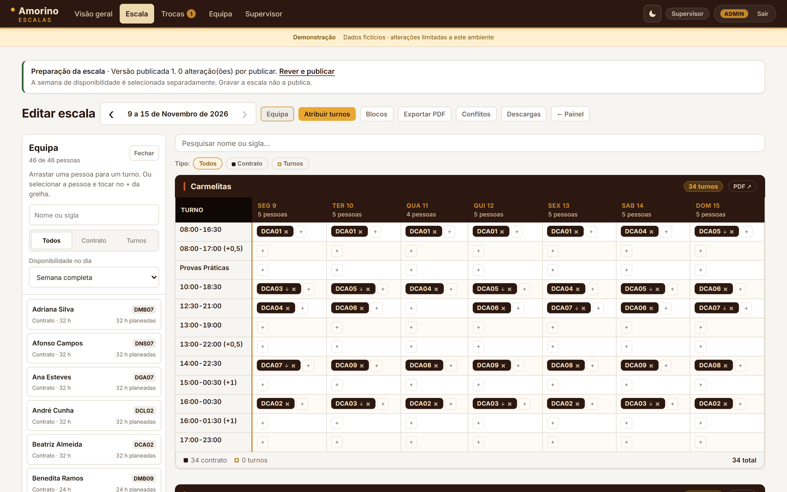

# Amorino Escalas

**Shift-scheduling web app for the Amorino ice-cream stores in Porto & Gaia:
5 stores and about 46 staff.**

Staff submit their weekly availability from their phones. The supervisor builds
the rota (*escala*) on a drag-and-drop grid, resolves conflicts, and publishes a
versioned schedule. Everyone can then see their shifts, request swaps, and
subscribe to their shifts in their phone calendar.

**[Project page with screenshots →](https://ffoliveira2005-design.github.io/amorino-shift-scheduler/)**



> All names in this repository and its screenshots are fictional. The
> screenshots come from the built-in demo dataset (`scripts/demo.py`). The
> interface is in European Portuguese because the staff work in Portuguese.

---

## What it does

| Area | Features |
|---|---|
| **Availability** | Staff mark the shifts they can work each week, on a mobile-first form. The supervisor sees who has answered and who hasn't. |
| **Schedule editor** | A per-store weekly grid with drag-and-drop or tap-to-assign, search and contract-type filters, and live planned hours against each contract. Changes stay in a draft until they are published. |
| **Suggestions** | Ranks candidates for an empty slot by availability, contract hours, rest days and a recency-weighted affinity learned from past schedules. |
| **Conflicts** | Flags people over or under their contract hours, shifts on days someone marked unavailable, two shifts on the same day, and junior staff left to open or close alone. |
| **Publication** | Publishing is an explicit, versioned step. Staff always see the last published version, and every later change is recorded in the version history. |
| **Swaps & donations** | Staff can request a direct swap or offer a shift to colleagues. A supervisor approves or rejects it, and the schedule updates atomically. |
| **Management overview** | Weekly KPIs (coverage, planned hours, responses, pending decisions), coverage per store and day, and a presentation mode. |
| **Exports** | Schedule PDFs (whole week, per store, per person) with ReportLab, an hours CSV, and personal `.ics` calendar feeds. |
| **Operations** | Consistent online backups, verified restore, a pre-flight config check, a migration rehearsal and a timed recovery rehearsal. Includes systemd and nginx examples. |

## Engineering highlights

- **Security built in from the start** ([SECURITY.md](SECURITY.md)). PINs are
  hashed with PBKDF2-SHA256 and checked in constant time, with a dummy hash for
  unknown users so response times don't reveal who exists. Failed logins are
  rate-limited. Every state-changing request needs a CSRF token. Sessions rotate
  their ID at login and expire on the server. Responses carry strict security
  headers. New accounts are activated with single-use 256-bit invites, of which
  only the SHA-256 is stored. A reset immediately revokes the old PIN, sessions
  and calendar token.
- **XSS discipline.** Jinja autoescaping is used with no `|safe` overrides. Any
  DOM built from API data uses `textContent` or an `escHtml()` helper, which
  matters because staff-typed notes are rendered in the supervisor's browser.
- **Correctness under concurrency.** It runs as one worker process with threads,
  SQLite in WAL mode, and conditional atomic updates for publication, invites
  and swap approval. Tests cover concurrent publication.
- **Time is hard, and handled.** Overnight shifts (`16:00-01:30 (+1)`), lunch
  break rules, Lisbon dates on hosts without tzdata, year boundaries and
  Portuguese public holidays are all handled.
- **No build step.** Server-rendered Jinja templates with a small vanilla-JS
  layer, a light/dark design system in plain CSS, a self-hosted Inter font and
  an installable PWA manifest.
- **Tested.** 502 pytest tests (about 10k lines) cover routes, authorization,
  scheduling rules, publication, exports, recovery and security regressions.
  Node runs the browser-side functions as part of the same suite, without a
  headless browser.

## Tech stack

| Layer | Choice |
|---|---|
| Language | Python 3.14 |
| Web | Flask 3, Flask-SQLAlchemy |
| Database | SQLite (WAL) |
| Frontend | Jinja2, vanilla JS, CSS (no framework, no bundler) |
| PDF / calendar | ReportLab, `qrcode`, iCalendar feeds |
| Tests | pytest + Node.js for JS unit checks |
| Deploy | `waitress` via `wsgi.py`, behind nginx, run by systemd |

## Try it locally

```bash
pip install -r requirements.txt
python scripts/demo.py
```

This starts the real app at `http://127.0.0.1:5001` with a fresh, fictional
dataset: 5 stores, 46 people and current weeks. It prints the demo sign-in
details when it starts. The demo database lives in `tmp/` and is reset on every
launch.

Run the tests against a disposable database:

```bash
AMORINO_DB_PATH=/tmp/amorino_test.db python -m pytest -q
```

## Project layout

```
app.py            routes and request handling (Flask)
models.py         SQLAlchemy models
config.py         stores, shift slots, ranks, labels
gerar_pdf.py      schedule → PDF (ReportLab)
wsgi.py           production entry point, enforces the pre-flight check
helpers/          auth, scoring, suggestions, publication, audit, time math
templates/        Jinja2 templates (base.html holds the design system)
static/           CSS, JS, fonts, icons
scripts/          demo, backup/restore/verify, pre-flight, migrations, import
ops/              systemd units, nginx example, backup jobs
tests/            pytest suite + Node-run JS tests
docs/             reference docs (mostly Portuguese) and changelog
site/             this project's GitHub Pages showcase
```

## About

Built by **Felipe Oliveira** for the team at the Amorino stores in Porto and
Gaia, to replace the weekly PDF rota.
[GitHub](https://github.com/ffoliveira2005-design)

The source is shared for portfolio purposes. All rights reserved.
